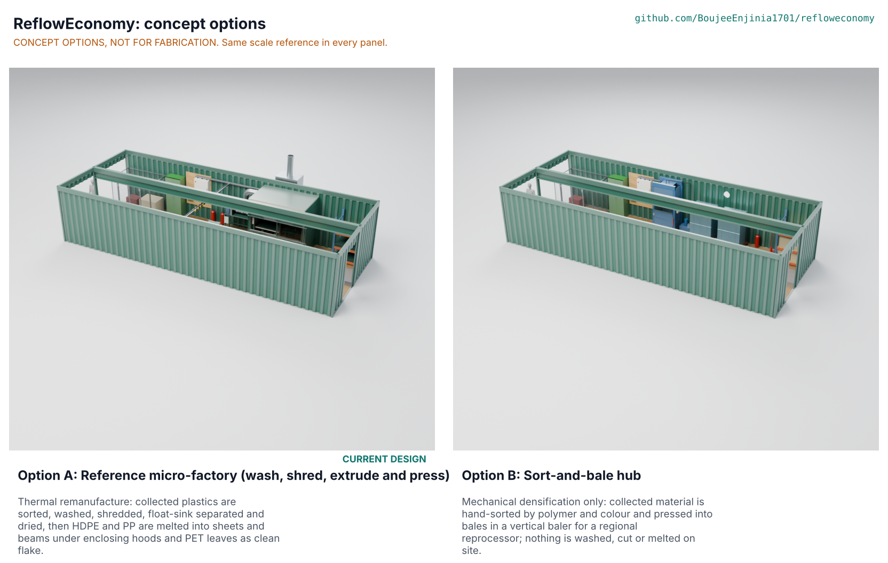

# ReflowEconomy concept options

Recommendation: the sort-and-bale hub (B) scores higher than the reference micro-factory (A), 228 against 180 of 295, so the choice goes to Amish. The recommendation is to keep A as the playbook's reference design, because B does not do what the pitch promises (recover and remanufacture locally) and scores 1 of 5 on keeping value local, and to graft B's best idea onto A: a site can open as a sort-and-bale hub on a single-phase supply and add the wash, shred and melt line once its supply and buyers are confirmed. Proposed, awaiting Amish (RFE-DEC-001 D4, RFE-DDR-004). Method: STANDARDS section 21.

*Figure 1. The two options at one scale, rendered in Blender Cycles from `components()` in `cad/src/model.py` by `python .kit/options.py` (rendered on Amish's machine).*

## The options

### Option A: reference micro-factory (wash, shred, extrude and press)

Working principle: thermal remanufacture. Collected plastics are hand-sorted, washed, shredded, float-sink separated and dried; HDPE and PP are melted into 1 x 1 m sheets and beams under two enclosing hoods, and PET leaves as clean flake. This is the existing design (RFE-PRC-001, RFE-CAL-001, RFE-BLD-001), unchanged except for the 120 mm feed slot fixed under the STEM check (RFE-DEC-001 D3).

On paper it takes 100 kg of collected input a shift and keeps 51.6 % local as products and flake, sends 28.4 % to licensed disposal and uses 0.88 kWh per kilogram of output. Its equipment is USD 25,505 (indicative, USD 505 over the value-engineering target). Counted as currents, its morning loads draw about 55 A from a supply decided as 230 V, 40 A single-phase (RFE-STM-001 S14; RFE-DEC-001 D1). Key risks: the supply; throughput margins on the shredder and the derated press; fumes and exposure, which only air monitoring can confirm; the product price (the site breaks even at 2.49 USD/kg of product, while regenerated HDPE sheet is listed in India at about 0.5 to 1 USD/kg, RFE-MKT-001). From a co-design partner it needs the input mix, local prices and buyers for sheets and beams, and the supply a site can get.

### Option B: sort-and-bale hub

Working principle: mechanical densification only. Collected material is weighed, hand-sorted by polymer and colour at two sorting tables into eight bins and three bulk bags, and pressed into bales of about 120 kg in a 10 t electro-hydraulic vertical baler; bales go to a regional reprocessor with a passport. Nothing is washed, shredded or melted, so there is no wet area, no hot zone and no fume extraction. Modelled at D3 in the same container shell (`cad/src/detail_b.py`): scale, two tables, eight bins, three bulk-bag stands, the baler with its power pack, two pallets of bales, a pallet truck, the export cage, safety station, board, racking and desk.

First-order numbers: three sorters at the 25 kg/h of RFE-CAL-001 for 4 h and a fourth person weighing, baling and issuing passports handle about 300 kg a shift (RFE-STM-001 B4). Per 100 kg of input, 60 kg of sorted plastic, 8 kg of metals and 10 kg of paper are baled for sale, 2 kg of e-waste is exported and 20 kg of residue goes to disposal; none is remanufactured on site. The baler, lights and a fan need about 24 A (B3). Key risks: bale prices (unwashed PET bottle scrap is listed in India at about INR 55/kg, about 0.58 USD/kg; HDPE and PP bale prices to assess), the value leaves for regional reprocessing, a high fire load of stored bales, and the crush hazard of the baler (interlocked loading gate). From a co-design partner it needs the reprocessors who would buy bales, their grade rules and prices.

### Screened out before modelling

A third principle was screened and not modelled: melt-mixing shredded plastic with sand into paving blocks. It is a melt route like A, with the fume hazard of mixing in open or semi-open kettles, an abrasive product that sheds plastic as it wears, and a single low-value product, so it adds nothing A does not already test.

## First-order numbers

Table 1. Options compared (model figures from `cad/fidelity.json`; costs indicative).

| Quantity | Option A | Option B |
| --- | --- | --- |
| Estimated equipment cost (USD) | 25,505 (bom/bom.csv items 1 to 12) | About 8,000: A's lines 1, 8, 9, 10, 11 and 12 at their indicative prices (USD 6,450) plus a 10 t vertical baler listed at INR 150,000 (about USD 1,570 at INR 95.46 per USD); second table, bag stands and pallet truck to assess |
| Model mass, all parts (kg) | 9,779 | 7,685 |
| Input per 8 h shift | 100 kg | About 300 kg (sorting-limited) |
| Output per 100 kg of input | 32.3 kg products, 19.3 kg clean flake; 28.4 kg to disposal | 60 kg sorted baled plastic, 18 kg baled metals and paper; 20 kg to disposal |
| Kept local as products or clean feedstock | 51.6 % | 0 % (bales go to a regional reprocessor) |
| Energy | 45.6 kWh per shift, 0.88 kWh/kg of output | About 9 kWh per shift (baler about 2 h of cycles, lights, fan), under 0.05 kWh/kg |
| Supply current, morning block | About 55 A running on a 40 A single-phase supply | About 24 A |
| Parts in the D3 model | 1,005 (294 fasteners, 168 welds) | 605 (153 fasteners, 92 welds) |
| STEM check | Open: S14 supply (to Amish), S15 noise and S21 exposure (site data) | Within known science; B1 bale density to confirm |

## Scoring

Table 2. Weighted scoring against RFE-URS-001 (weights: High UR 3, Medium 2; scores 1 to 5).

| Criterion | Source | Weight | A | B | Reason |
| --- | --- | --- | --- | --- | --- |
| What to process here | UR-001 | 3 | 4 | 4 | The feasibility matrix serves both |
| Recipes we can follow | UR-002 | 3 | 4 | 4 | A has four process recipes; B needs sorting and baling rules only |
| Know if it pays | UR-003 | 3 | 3 | 3 | Both use the economics model; A breaks even only at its assumed product price, B's bale prices are to assess |
| Send away safely | UR-004 | 2 | 3 | 3 | Same export cage and rules in both |
| Fit a small site | UR-005 | 3 | 4 | 5 | A fits with its hot zone at the 1.0 m limit; B fits with room to spare |
| Handle a day's collection | UR-006 | 3 | 3 | 5 | A is at risk (shredder 5 % margin); B handles about 300 kg |
| Keep value local | UR-007 | 3 | 4 | 1 | A keeps 51.6 % local as products and flake; B adds only sorting value and ships bales away |
| Little to disposal, nothing burned | UR-008 | 3 | 2 | 3 | A 28.4 % with process losses; B 20 %, the sorting residue alone |
| Low electricity bill | UR-009 | 2 | 3 | 5 | 0.88 against under 0.05 kWh/kg |
| Use the supply we can get | UR-010 | 3 | 1 | 5 | A needs about 55 A on paper against 40 A; B about 24 A |
| Clean air | UR-011 | 3 | 3 | 5 | A melts plastic under hoods (to verify); B melts nothing |
| Safe machines | UR-012 | 3 | 3 | 4 | A has a shredder, hot presses and noise; B has one interlocked baler |
| Trusted material | UR-013 | 3 | 4 | 3 | Passports on both; A's flake and products carry more process data |
| Quick records | UR-014 | 2 | 3 | 3 | Same desk and passport |
| Build and repair locally | UR-015 | 2 | 3 | 4 | A needs three open machines built by a capable workshop; B a bought baler and simple frames |
| Affordable equipment | UR-016 | 2 | 2 | 4 | USD 25,505 against about USD 8,000 |
| Permittable | UR-017 | 3 | 3 | 4 | Both register as processors; A also needs an air consent for melting (to assess) |
| Fire safety | UR-018 | 3 | 3 | 4 | A has a hot zone beside plastic stock; B a high fire load of bales but no heat |
| Fair intake rules | UR-019 | 2 | 3 | 3 | Same intake rule |
| Cost against the value-engineering target | PR-010 | 2 | 3 | 5 | A USD 505 over the USD 25,000 target; B well under |
| Buildable with local skills and tools | BLD | 2 | 3 | 4 | A's booth, enclosure and ducting against B's frames and a bought baler |
| Safety, overall hazard profile | RSK | 3 | 3 | 4 | Fewer and lower hazards in B |
| Maintenance | RSK | 1 | 2 | 4 | A has filters, heaters, cutters and three drives; B one hydraulic pack |
| **Weighted total** | | | **180** | **228** | Of 295 |

## Recommendation

B outscores A by more than 10 %, so this goes to Amish as a decision (STANDARDS section 21; the repo is not redesigned without his go). The scores favour B because it uses little power, needs little capital and has few hazards; most of A's lost points come from its supply problem (RFE-DEC-001 D1) and its thin economics. But B does not meet the pitch: it recovers and sorts but does not remanufacture, and the value leaves the community as bales (UR-007 scores 1 of 5). The recommendation is to keep A as the reference micro-factory and to graft B's best idea onto it as a staged start: the playbook describes how a site opens as a sort-and-bale hub on single phase (B's tables, bins, bag stands and baler fit A's front row and cage), earns while it finds buyers and the right supply, and then adds the wash, shred and melt line. A change of reference to B, or the staged start, changes the playbook's scope and is Amish's decision (RFE-DEC-001 D4, argued in RFE-DDR-004).
